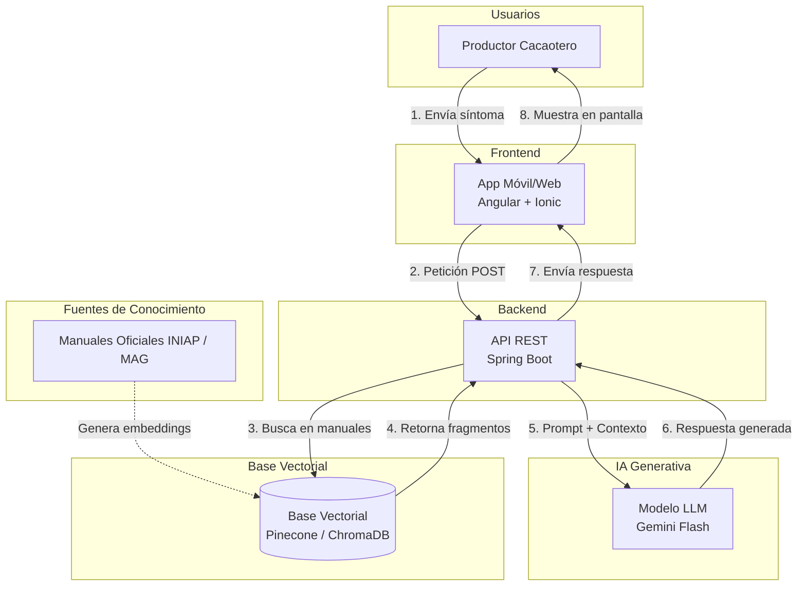

# Arquitectura del Sistema y Flujo de Datos

El "Asistente Agrotécnico para Productores de Cacao" utiliza una arquitectura basada en **RAG (Retrieval-Augmented Generation)**. Este enfoque permite que el modelo de lenguaje (LLM) genere respuestas precisas utilizando únicamente nuestra base de conocimiento oficial.

## Diagrama de Arquitectura

