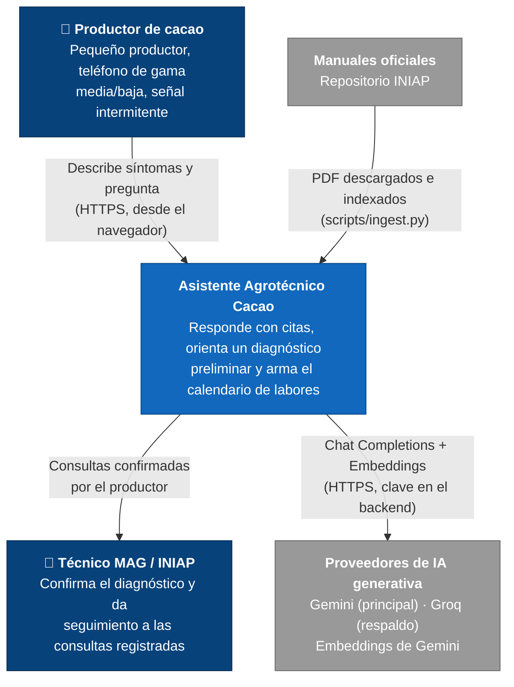
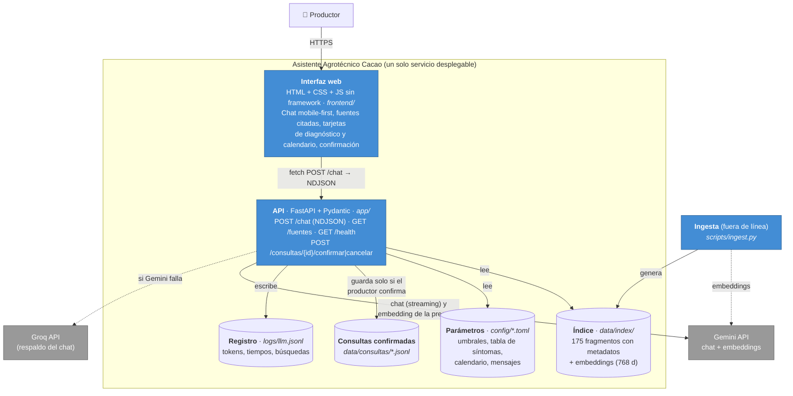
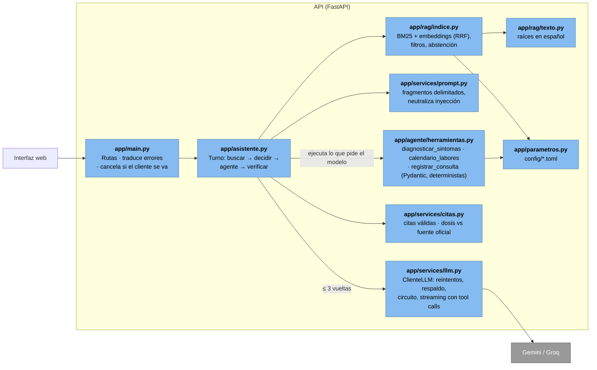
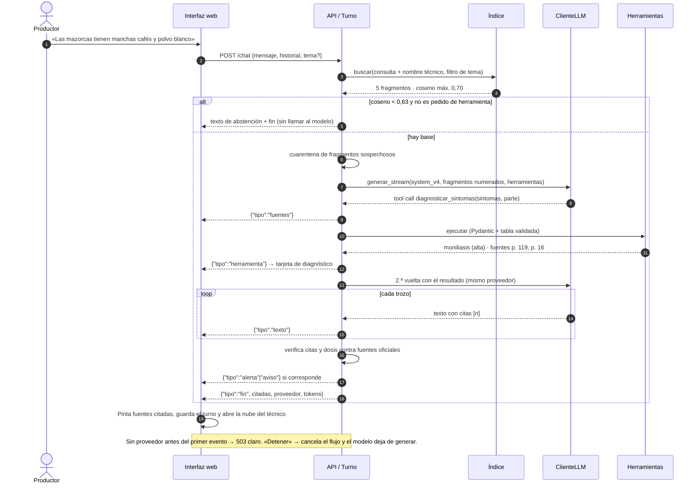

# Arquitectura del Sistema (modelo C4)

El Asistente Agrotécnico para Productores de Cacao es una aplicación web mobile-first con un backend FastAPI que
encapsula al modelo generativo. Desde la semana 3 responde con **RAG y citas** sobre los manuales del INIAP, y un
**agente** con tres herramientas deterministas orienta el diagnóstico, arma el calendario y registra consultas con
confirmación humana. Decisiones en [09-decisiones.md](09-decisiones.md); detalle del RAG en [06-rag.md](06-rag.md).

## Nivel 1 · Contexto

## Nivel 2 · Contenedores

## Nivel 3 · Componentes de la API

**Reglas de dependencia:** solo `app/services/llm.py` conoce al proveedor del chat, y solo `app/rag/embeddings.py`
conoce al de embeddings. Las herramientas no llaman al modelo. Los umbrales, tablas y textos fijos viven en `config/`.

## Flujo de una consulta (`POST /chat`)

## Atributos de calidad y cómo se atienden

| Atributo | Mecanismo | Dónde |
| :--- | :--- | :--- |
| Fundamentación (LLM09) | Respuestas solo con fragmentos, cita `[n]` obligatoria, fuentes con página enlazada | `system_v4.md`, `app/asistente.py`, `frontend/app.js` |
| Abstención | Umbral calibrado (código) + prompt; mensaje que orienta al técnico | `config/rag.toml`, `app/rag/indice.py` |
| Seguridad de agroquímicos | Dosis verificadas contra fuentes oficiales; alerta si no aparecen; aviso de registro en Agrocalidad | `app/services/citas.py` |
| Inyección indirecta (LLM01) | Fragmentos delimitados y neutralizados; cuarentena por patrones; documento ajeno no respalda dosis | `app/services/prompt.py`, `config/rag.toml` |
| Agencia excesiva (LLM06) | Herramientas deterministas, ≤ 3 vueltas, argumentos validados, registro solo con confirmación humana | `app/agente/`, `config/agente.toml` |
| Disponibilidad | Reintentos, `Retry-After`, respaldo, interruptor de circuito; búsqueda sigue con BM25 si fallan los embeddings | `app/services/llm.py`, `app/rag/` |
| Consumo excesivo (LLM10) | Mensaje ≤ 1000 caracteres, historial ≤ 10 turnos, 5 fragmentos, `max_tokens`, cancelación con «Detener» | `app/schemas.py`, `config/` |
| Salida insegura (LLM05) | La respuesta se escapa antes de mostrarse; las citas se convierten en botones, no en HTML del modelo | `frontend/app.js` |
| Usabilidad móvil | Mobile-first 360 px, tarjetas plegables, tablas con desplazamiento propio | `frontend/styles.css` |
| Observabilidad | Una línea JSON por llamada y por búsqueda (decisión, coseno, fragmentos), sin texto del usuario | `logs/llm.jsonl` |
